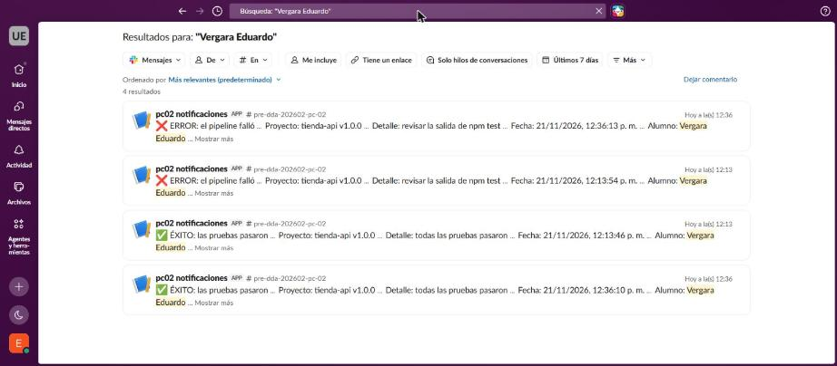
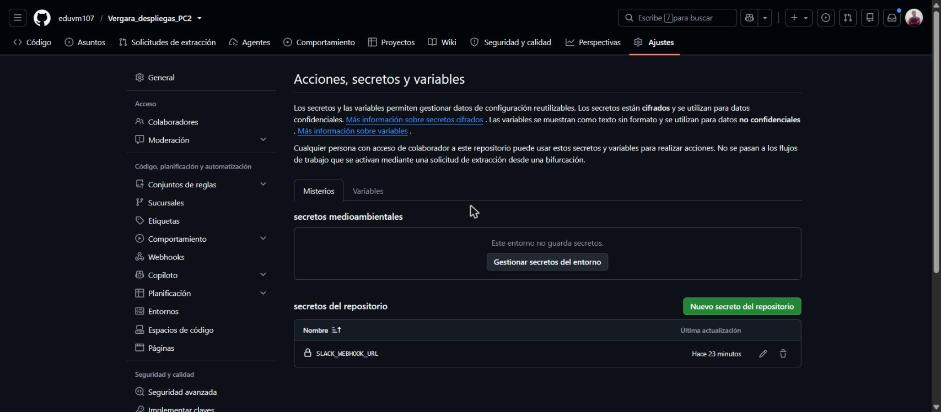
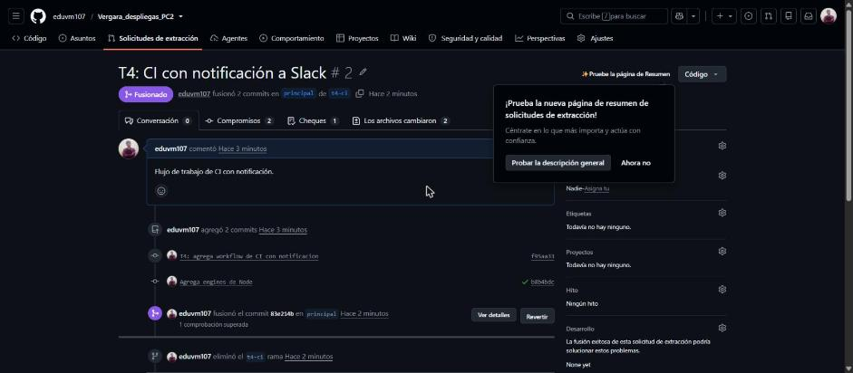
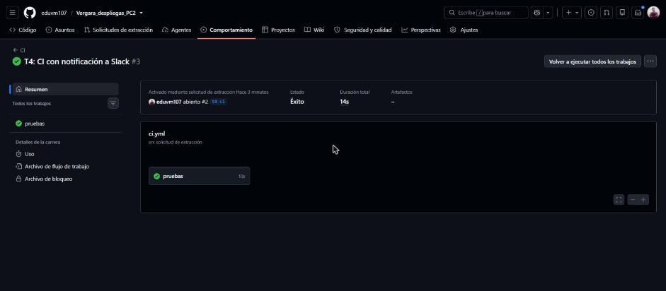
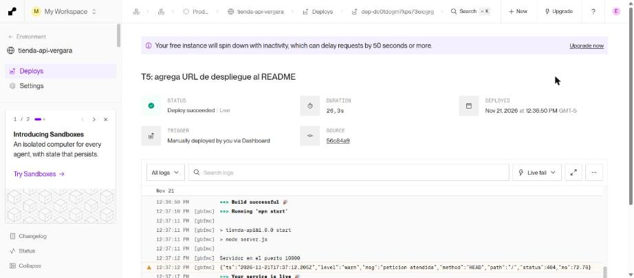
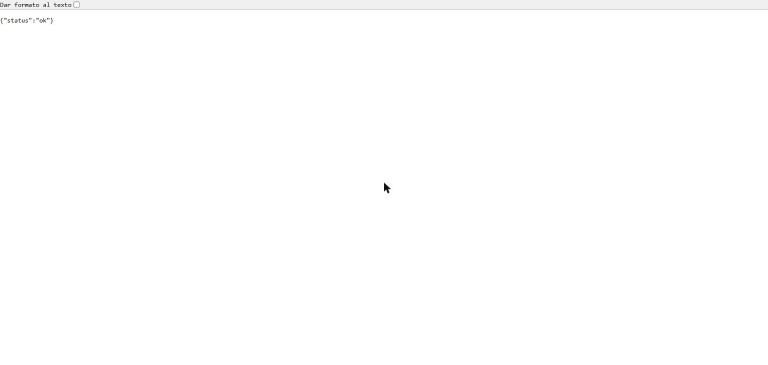
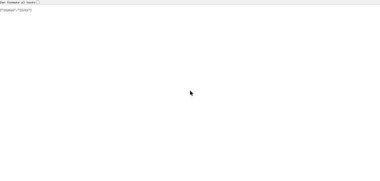
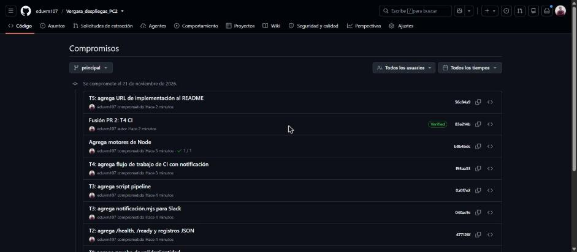

# tienda-api (PC02 - Despliegue de Aplicaciones)

API de ejemplo sin dependencias. Requiere Node.js 20 o superior.

    npm test            # ejecuta las pruebas
    npm run test:cov    # pruebas con cobertura
    npm start           # inicia el servidor en el puerto 3000
    node verificar.mjs  # autoverificación de la parte práctica
    npm run pipeline    # pruebas y notificación a Slack (requiere SLACK_WEBHOOK_URL)

Rutas: `/health`, `/ready`, `/productos` y `/total?ids=1,2&cupon=DESC10`.
Las instrucciones de la práctica están en el enunciado de la PC02.

## Despliegue

- Plataforma: Render
- URL: https://tienda-api-vergara.onrender.com (salud: `/health`)

## Evidencias

### T1. Pruebas y cobertura

Antes de la corrección:

```
not ok 3 - cupón DESC10 descuenta 10 % antes del IGV
not ok 4 - el cupón se reconoce en minúsculas
# pass 3
# fail 2
```

Después (`npm run test:cov`):

```
# tests 6
# pass 6
# fail 0
#  precios.js      | 100.00 |   100.00 |  100.00 |
```

### T2. Observabilidad

```
GET /health -> {"status":"ok"} [200]
GET /ready  -> {"status":"listo"} [200]
BASE_DE_DATOS_OK=false
GET /ready  -> {"status":"no listo"} [503]
{"ts":"2026-11-21T17:35:50.271Z","level":"info","msg":"peticion atendida","method":"GET","path":"/health","status":200,"ms":11.56}
```

### T3. Notificación a Slack

```
$ npm run pipeline
# pass 6
# fail 0
Notificación enviada a Slack (exito).

$ npm run pipeline   (con una prueba rota)
# pass 5
# fail 1
Notificación enviada a Slack (error).

$ SLACK_WEBHOOK_URL= node notificar.mjs exito
Falta la variable de entorno SLACK_WEBHOOK_URL. No se envió la notificación.
codigo de salida: 1
```



### T4. Integración continua






### T5. Despliegue en Render

```
GET https://tienda-api-vergara.onrender.com/health -> {"status":"ok"} [200]
GET https://tienda-api-vergara.onrender.com/ready  -> {"status":"listo"} [200]
GET https://tienda-api-vergara.onrender.com/total?ids=1,2&cupon=desc10 -> {"total":11.15} [200]
```





### Historial


